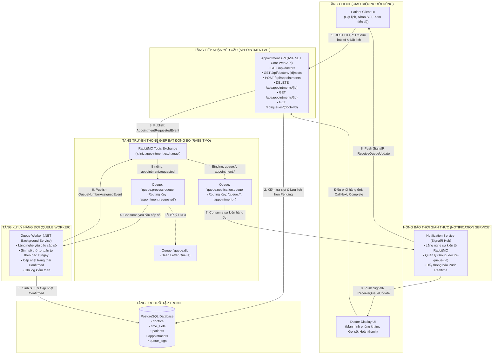

# SƠ ĐỒ VÀ BÁO CÁO KIẾN TRÚC TỔNG QUAN HỆ THỐNG
## Đề tài 09: Hệ thống Đặt lịch khám và Quản lý hàng đợi (Clinic Appointment & Queue Management System)

---

## 1. Sơ đồ kiến trúc tổng quan (System Architecture Diagram)

Hệ thống được thiết kế theo mô hình **Kiến trúc Hướng sự kiện phân tán (Distributed Event-Driven Architecture)** gồm các service độc lập giao tiếp qua REST API, RabbitMQ và SignalR:

---

## 2. Mô tả các thành phần trong hệ thống

### 2.1. Client (Giao diện người dùng)
- **Patient Client UI (`index.html`):** Cho phép người bệnh tra cứu bác sĩ, phòng khám, các khung giờ còn chỗ trống, đăng ký khám bệnh, nhận phiếu khám điện tử có số thứ tự và theo dõi tiến độ hàng đợi.
- **Doctor Display UI (`doctor.html`):** Màn hình hiển thị tại phòng khám cho bác sĩ/y tá. Hiển thị số thứ tự đang khám to rõ, danh sách chờ và cung cấp các nút thao tác nghiệp vụ: Gọi số tiếp theo (`Call Next`), Hoàn thành ca khám (`Complete`), Báo bệnh nhân vắng mặt (`No Show`).

### 2.2. Appointment API (Port 5001)
- Cung cấp các RESTful API tối thiểu theo đặc tả:
  - `GET /api/doctors`: Danh sách bác sĩ, phòng khám, chuyên khoa.
  - `GET /api/doctors/{id}/slots`: Danh sách khung giờ khám còn chỗ.
  - `POST /api/appointments`: Tiếp nhận đặt lịch, kiểm tra tính hợp lệ và slot trống, tạo lịch hẹn ở trạng thái `Pending`.
  - `DELETE /api/appointments/{id}`: Hủy lịch khám, giải phóng slot.
  - `GET /api/appointments/{id}`: Tra cứu thông tin chi tiết lịch hẹn và lịch sử.
  - `GET /api/queues/{doctorId}`: Tra cứu tình trạng hàng đợi hiện tại của phòng khám.
  - Các API điều phối hàng đợi: `POST /api/queues/{doctorId}/next`, `POST /api/queues/{doctorId}/complete`, `POST /api/queues/{doctorId}/noshow`.
- Đóng vai trò là **Message Producer**, kết nối bền bỉ với RabbitMQ để đưa yêu cầu cấp số vào `clinic.appointment.exchange` với routing key `appointment.requested`.

### 2.3. RabbitMQ Message Broker (Port 5672, Management: 15672)
- Quản lý message queue phân tán, phân tách phụ thuộc giữa API, Worker và Notification Service.
- Thiết kế **Topic Exchange**: `clinic.appointment.exchange`.
- Các Queue:
  - `queue.process.queue`: Lắng nghe sự kiện `appointment.requested`.
  - `queue.notification.queue`: Lắng nghe sự kiện `queue.*`, `appointment.*`.
  - `queue.dlq`: Hàng đợi thư chết hứng các message lỗi để đối soát và bảo vệ hệ thống không bị crash.

### 2.4. Queue Worker (Background Service)
- Lắng nghe message từ `queue.process.queue`.
- Thực hiện logic nghiệp vụ cốt lõi: Tính toán số thứ tự tăng dần tự động cho từng bác sĩ trong ngày (`queue_number`).
- Cập nhật trạng thái lịch hẹn từ `Pending` $\to$ `Confirmed`.
- Ghi nhật ký vào bảng `queue_logs`.
- Xác thực tin nhắn thủ công (`basicAck`), nack tin lỗi (`basicNack`).
- Phát sự kiện `QueueNumberAssignedEvent` lên RabbitMQ để kích hoạt thông báo realtime.

### 2.5. Notification Service (SignalR Hub - Port 5003)
- Lắng nghe sự kiện thay đổi hàng đợi từ `queue.notification.queue`.
- Đẩy thông báo thời gian thực về Client qua SignalR WebSockets:
  - `ReceiveQueueUpdate`: Cập nhật số đang phục vụ, danh sách chờ.
  - `ReceiveAppointmentStatus`: Cập nhật trạng thái phiếu khám của bệnh nhân.

### 2.6. PostgreSQL Database (Port 5432)
- Cơ sở dữ liệu quan hệ lưu trữ tập trung:
  - `doctors`: Thông tin bác sĩ, chuyên khoa, phòng khám.
  - `time_slots`: Khung giờ khám, số lượng tối đa (`max_capacity`), số lượng đã đặt (`current_bookings`).
  - `patients`: Hồ sơ bệnh nhân (họ tên, số điện thoại, CCCD).
  - `appointments`: Lịch khám, số thứ tự, trạng thái.
  - `queue_logs`: Nhật ký kiểm toán lịch sử thay đổi trạng thái hàng đợi.
