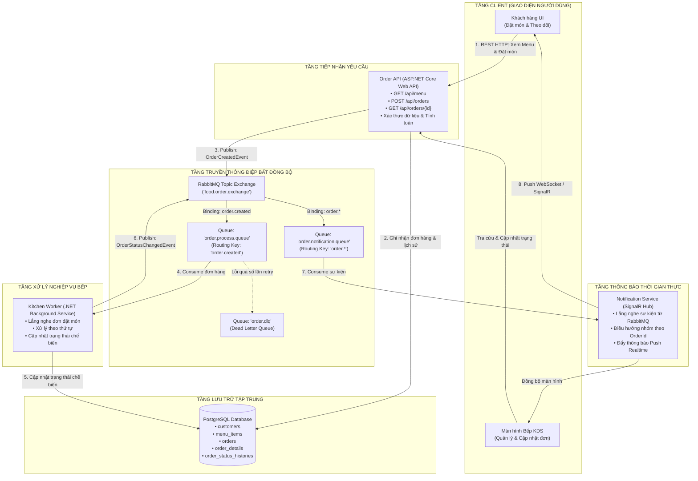
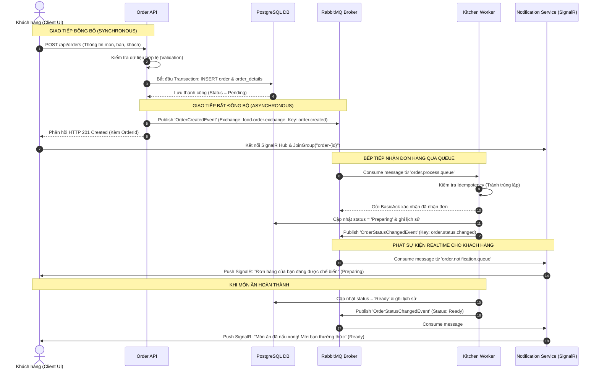

# SƠ ĐỒ VÀ BÁO CÁO KIẾN TRÚC TỔNG QUAN HỆ THỐNG
## Đề tài 04: Hệ thống Đặt món và Xử lý tại Bếp (Food Ordering & Kitchen Processing)

---

## 1. Sơ đồ kiến trúc tổng quan (System Architecture Diagram)

Hệ thống được thiết kế theo mô hình **Kiến trúc Hướng sự kiện phân tán (Distributed Event-Driven Architecture)** gồm 5 khối thành phần độc lập:

---

## 2. Luồng giao tiếp đầu-cuối (End-to-End Sequence Diagram)

Sơ đồ trình bày chi tiết sự kết hợp giữa **giao tiếp đồng bộ (Synchronous HTTP REST)** và **giao tiếp bất đồng bộ (Asynchronous AMQP/RabbitMQ)**:

---

## 3. Lý do lựa chọn bộ công nghệ

| Thành phần | Công nghệ lựa chọn | Lý do và Lợi ích kỹ thuật |
|---|---|---|
| **Backend Framework** | **ASP.NET Core 8 Web API (C#)** | - Hiệu năng cao (top benchmark thế giới). - Hệ sinh thái C# mạnh mẽ, Dependency Injection tích hợp sẵn. - Hỗ trợ SignalR nguyên bản cho realtime. - Chuẩn hóa theo chương trình giảng dạy PTUDPT tại các trường đại học. |
| **Message Broker** | **RabbitMQ (v3.13-management)** | - Hỗ trợ chuẩn giao thức AMQP 0-9-1. - Đảm bảo độ tin cậy tin nhắn (Message Durability, Acknowledgement, DLQ). - Có giao diện Web Management trực quan tại port 15672, hỗ trợ kiểm tra queue, rate, message payload một cách dễ dàng trong buổi bảo vệ. |
| **Cơ sở dữ liệu** | **PostgreSQL 16** | - Hệ quản trị CSDL quan hệ mã nguồn mở mạnh mẽ nhất hiện nay. - Hỗ trợ giao dịch ACID nghiêm ngặt (đặc biệt quan trọng khi tính tiền đơn hàng). - Tích hợp hoàn hảo với Entity Framework Core (`Npgsql.EntityFrameworkCore.PostgreSQL`). |
| **Truyền thông Realtime**| **ASP.NET Core SignalR** | - Tự động đàm phán phương thức truyền tải tốt nhất (ưu tiên WebSockets, fallback SSE/Long Polling). - Hỗ trợ định tuyến nhóm (`Groups.AddToGroupAsync`), cho phép chỉ gửi thông báo trạng thái đến đúng phiên khách hàng đặt đơn đó. |
| **Frontend Client** | **HTML5 / CSS3 / Modern JS (ES6+)** | - Nhẹ, không phụ thuộc vào chuỗi build phức tạp, chạy trực tiếp trên trình duyệt. - Dễ dàng tích hợp thư viện `@microsoft/signalr` qua CDN. - Cung cấp 2 giao diện riêng biệt: Khách hàng đặt món và Màn hình bếp KDS. |
| **Containerization** | **Docker & Docker Compose** | - Đóng gói môi trường đồng nhất. - Khởi động toàn bộ CSDL, Message Queue chỉ bằng lệnh `docker compose up -d`. |
