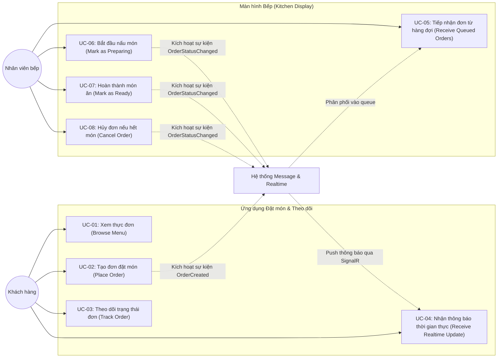

# BIỂU ĐỒ VÀ ĐẶC TẢ CA SỬ DỤNG (USE CASE DIAGRAM & SPECIFICATION)
## Đề tài 04: Hệ thống Đặt món và Xử lý tại Bếp

---

## 1. Xác định tác nhân (Actors)

1. **Khách hàng (Customer):**
   - Là người dùng tương tác với hệ thống tại bàn ăn hoặc thiết bị di động.
   - Thao tác: Xem thực đơn, thêm món vào giỏ, tạo đơn đặt món, theo dõi trạng thái món ăn và nhận thông báo khi món sẵn sàng.
2. **Nhân viên bếp (Kitchen Staff / Chef):**
   - Là người trực tiếp tiếp nhận thông tin đơn hàng và chế biến tại bếp.
   - Thao tác: Quan sát hàng đợi đơn hàng mới, cập nhật trạng thái làm món (`Preparing`, `Ready`, `Cancelled`).
3. **Hệ thống hàng đợi & thông báo (Message Broker & Notification System):**
   - Tác nhân hệ thống thực hiện chuyển tiếp thông điệp và kích hoạt gửi sự kiện realtime đến các phiên làm việc.

---

## 2. Sơ đồ Use Case Diagram (Mermaid)

---

## 3. Đặc tả chi tiết các Use Case chính

### 3.1. UC-02: Tạo đơn đặt món (Place Order)
- **Actor:** Khách hàng (Customer)
- **Tiền điều kiện (Pre-conditions):**
  - Khách hàng đã mở ứng dụng và tải được danh mục món ăn (UC-01).
  - Có ít nhất một món ăn được chọn trong giỏ hàng với số lượng > 0.
- **Hậu điều kiện (Post-conditions):**
  - Đơn hàng được lưu vào PostgreSQL với trạng thái `Pending`.
  - Sự kiện `OrderCreatedEvent` được gửi lên RabbitMQ Exchange `food.order.exchange`.
  - Khách hàng nhận được `OrderId` và tự động tham gia nhóm nhận tin realtime của đơn hàng đó.
- **Luồng sự kiện chính (Basic Flow):**
  1. Khách hàng bấm nút "Xác nhận đặt món" trên màn hình giỏ hàng.
  2. Client gửi yêu cầu `POST /api/orders` với danh sách món (`menuItemId`, `quantity`, `notes`) và thông tin khách hàng (`customerName`, `tableNumber`).
  3. Order API xác thực dữ liệu: kiểm tra món ăn có tồn tại và đang sẵn sàng phục vụ (`is_available = true`).
  4. Order API tính toán tổng tiền dựa trên giá gốc từ database (tránh việc client giả mạo giá).
  5. Order API lưu đơn hàng và các dòng chi tiết vào CSDL trong một Transaction.
  6. Order API ghi log trạng thái ban đầu `Pending` vào `order_status_histories`.
  7. Order API serialize sự kiện `OrderCreatedEvent` và publish lên RabbitMQ Exchange với routing key `order.created`.
  8. Order API trả về mã phản hồi `201 Created` kèm thông tin đơn hàng vừa tạo cho Client.
  9. Client hiển thị thông báo thành công và chuyển sang giao diện theo dõi tiến trình.
- **Luồng ngoại lệ (Alternative / Exception Flow):**
  - *Dữ liệu không hợp lệ (món không có hoặc số lượng $\le$ 0):* API trả về `400 Bad Request`, Client hiển thị thông báo lỗi cụ thể.
  - *RabbitMQ broker tạm thời không khả dụng:* API vẫn lưu đơn vào Database và ghi log cảnh báo lỗi gửi message hoặc lưu vào bảng Outbox để retry sau (Outbox pattern).

---

### 3.2. UC-06 & UC-07: Bếp tiếp nhận và cập nhật trạng thái làm món
- **Actor:** Nhân viên bếp (Kitchen Staff)
- **Tiền điều kiện:**
  - Kitchen Worker đã khởi động và kết nối thành công tới queue `order.process.queue`.
  - Đơn hàng ở trạng thái `Pending` hoặc `Preparing`.
- **Hậu điều kiện:**
  - Trạng thái đơn hàng trong CSDL được cập nhật thành `Preparing` hoặc `Ready`.
  - Lịch sử thay đổi trạng thái được ghi thêm 1 bản ghi mới.
  - Sự kiện `OrderStatusChangedEvent` được publish lên RabbitMQ với routing key `order.status.changed`.
- **Luồng sự kiện chính:**
  1. Bếp nhìn thấy đơn hàng mới xuất hiện trên giao diện Kitchen Display.
  2. Bếp bấm nút **"Bắt đầu nấu"** (chuyển sang `Preparing`).
  3. Yêu cầu cập nhật trạng thái được gửi lên Order API / Kitchen Service.
  4. Trạng thái trong DB cập nhật thành `Preparing`, ghi log `order_status_histories`.
  5. Sự kiện `OrderStatusChangedEvent` được phát vào RabbitMQ.
  6. Khi món ăn nấu xong, đầu bếp bấm nút **"Đã xong"** (chuyển sang `Ready`).
  7. Trạng thái trong DB cập nhật thành `Ready`, phát sự kiện `OrderStatusChangedEvent`.
  8. Giao diện bếp chuyển đơn sang cột "Đã hoàn thành".

---

### 3.3. UC-04: Nhận thông báo thời gian thực (Receive Realtime Update)
- **Actor:** Khách hàng (Customer) & Notification Service
- **Tiền điều kiện:**
  - Client đã kết nối SignalR Hub `http://localhost:5003/hubs/order-notification`.
  - Client đã tham gia Group theo mã đơn hàng: `JoinOrderGroup(orderId)`.
- **Luồng sự kiện:**
  1. Notification Service lắng nghe queue `order.notification.queue`.
  2. Khi nhận được message `OrderStatusChangedEvent`:
  3. Notification Service trích xuất `OrderId`, `NewStatus`, `Message`, `Timestamp`.
  4. Notification Service gọi SignalR Hub: gửi message tới đúng Group `order-{orderId}`.
  5. Client nhận sự kiện realtime từ SignalR:
     - Biểu tượng tiến trình tự động nhảy bước (`Pending` $\to$ `Preparing` $\to$ `Ready`).
     - Hiển thị âm thanh/thông báo pop-up chúc mừng món ăn đã nấu xong.
