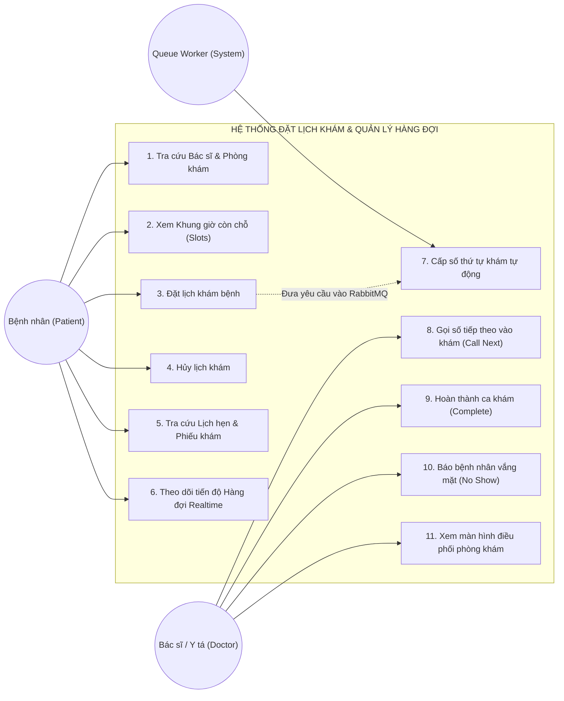

# BIỂU ĐỒ VÀ ĐẶC TẢ USE CASE HỆ THỐNG
## Đề tài 09: Hệ thống Đặt lịch khám và Quản lý hàng đợi (Clinic Appointment & Queue Management System)

---

## 1. Biểu đồ Use Case tổng quan (Use Case Diagram)

---

## 2. Đặc tả các Use Case chính

### Use Case 1: Đặt lịch khám bệnh (UC3)
- **Actor chính:** Bệnh nhân (Patient).
- **Mục tiêu:** Đăng ký lịch khám với bác sĩ chuyên khoa vào một khung giờ cụ thể và gửi yêu cầu cấp số thứ tự vào hệ thống.
- **Tiền điều kiện:** Bác sĩ còn hoạt động và khung giờ đã chọn còn chỗ trống (`current_bookings < max_capacity`).
- **Luồng sự kiện chính:**
  1. Bệnh nhân chọn Bác sĩ và Khung giờ muốn khám.
  2. Bệnh nhân nhập thông tin cá nhân: Họ tên, Số điện thoại, CCCD, Triệu chứng ban đầu.
  3. Client gửi request `POST /api/appointments` đến Appointment API.
  4. Hệ thống kiểm tra điều kiện slot trong DB Transaction.
  5. Hệ thống tăng số lượng đặt của khung giờ (`current_bookings += 1`), tạo bản ghi lịch hẹn ở trạng thái `Pending`.
  6. Hệ thống đưa message `AppointmentRequestedEvent` vào RabbitMQ Exchange.
  7. Hệ thống trả về thông tin lịch hẹn đã tạo (mã `201 Created`).
- **Luồng ngoại lệ:** Khung giờ đã hết chỗ $\to$ Trả về mã lỗi `400 Bad Request`, thông báo bệnh nhân chọn khung giờ khác.

---

### Use Case 2: Cấp số thứ tự khám tự động (UC7)
- **Actor:** Queue Worker (System Background Service).
- **Mục tiêu:** Tiếp nhận yêu cầu cấp số từ RabbitMQ và sinh số thứ tự liên tục, không trùng lặp cho từng phòng khám trong ngày.
- **Tiền điều kiện:** Có message `appointment.requested` trong `queue.process.queue`.
- **Luồng sự kiện chính:**
  1. Queue Worker nhận message từ queue.
  2. Worker truy vấn CSDL để tìm số thứ tự lớn nhất hiện tại của bác sĩ trong ngày: `MAX(queue_number)`.
  3. Worker tính toán số thứ tự mới: `new_queue_number = (max ?? 0) + 1`.
  4. Worker cập nhật bản ghi lịch hẹn: `queue_number = new_queue_number`, `status = Confirmed`.
  5. Worker ghi nhật ký kiểm toán vào `queue_logs`.
  6. Worker gửi xác nhận ACK (`basicAck`) về RabbitMQ.
  7. Worker phát sự kiện `QueueNumberAssignedEvent` lên RabbitMQ.
  8. Notification Service nhận sự kiện và gửi thông báo SignalR đến Client của bệnh nhân.

---

### Use Case 3: Gọi số thứ tự tiếp theo vào phòng khám (UC8)
- **Actor:** Bác sĩ / Y tá phụ trách phòng khám (Doctor).
- **Mục tiêu:** Gọi bệnh nhân tiếp theo trong danh sách chờ vào phòng khám.
- **Tiền điều kiện:** Bác sĩ đang xem màn hình điều phối phòng khám (`doctor.html`).
- **Luồng sự kiện chính:**
  1. Bác sĩ bấm nút **"Gọi số tiếp theo"**.
  2. Client gửi request `POST /api/queues/{doctorId}/next` đến Appointment API.
  3. Nếu có ca khám đang dở dang (`Serving`), hệ thống tự động hoàn thành ca đó (`Completed`).
  4. Hệ thống tìm bệnh nhân kế tiếp có số thứ tự nhỏ nhất ở trạng thái `Confirmed`.
  5. Hệ thống cập nhật trạng thái của bệnh nhân này thành `Serving`.
  6. Hệ thống ghi nhật ký vào `queue_logs`.
  7. Hệ thống phát sự kiện `QueueServingChangedEvent` lên RabbitMQ (`queue.serving.changed`).
  8. Notification Service đẩy sự kiện realtime qua SignalR Hub tới tất cả client đang theo dõi bác sĩ đó.
  9. Màn hình bác sĩ và màn hình bệnh nhân lập tức cập nhật số đang phục vụ.
