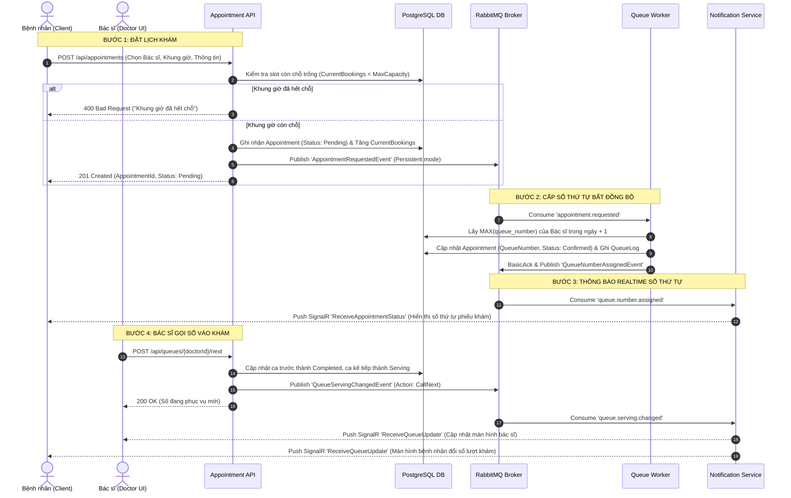

# BÁO CÁO THIẾT KẾ KIẾN TRÚC CHI TIẾT CÁC SERVICE
## Đề tài 09: Hệ thống Đặt lịch khám và Quản lý hàng đợi (Clinic Appointment & Queue Management)

---

## 1. Phân chia trách nhiệm các Service (Separation of Concerns)

| Service | Công nghệ | Trách nhiệm chính |
|---|---|---|
| **Appointment API** | ASP.NET Core 8 Web API | Tiếp nhận HTTP REST từ Client, xác thực dữ liệu, quản lý bác sĩ và khung giờ, kiểm tra slot trống trong ACID transaction, lưu lịch hẹn ở trạng thái `Pending`, đưa message vào RabbitMQ. |
| **Queue Worker** | .NET 8 Worker Service | Background Consumer độc lập tiêu thụ message `appointment.requested`. Thực hiện thuật toán sinh số thứ tự tự động theo ngày/bác sĩ, cập nhật lịch hẹn sang `Confirmed`, ghi log kiểm toán và phát sự kiện `queue.number.assigned`. |
| **Notification Service** | ASP.NET Core 8 SignalR | Quản lý kết nối thời gian thực WebSockets/SignalR với client. Tiêu thụ các sự kiện hàng đợi từ RabbitMQ và broadcast thông báo đến đúng nhóm phòng khám (`doctor-queue-{id}`). |
| **PostgreSQL Database** | PostgreSQL 16 | Lưu trữ dữ liệu tập trung đảm bảo tính ACID, toàn vẹn khóa ngoại và ràng buộc duy nhất. |
| **RabbitMQ Broker** | RabbitMQ 3.13-management | Đảm bảo tính bất đồng bộ, đệm lưu lượng yêu cầu đặt khám khi cao điểm, phân phối sự kiện đa hướng (Pub/Sub). |
| **Client Frontend** | HTML5, CSS3, JS, SignalR | Cung cấp giao diện tương tác cho Bệnh nhân (`index.html`) và màn hình phòng khám cho Bác sĩ (`doctor.html`). |

---

## 2. Luồng giao tiếp toàn hệ thống (End-to-End Sequence Diagram)

