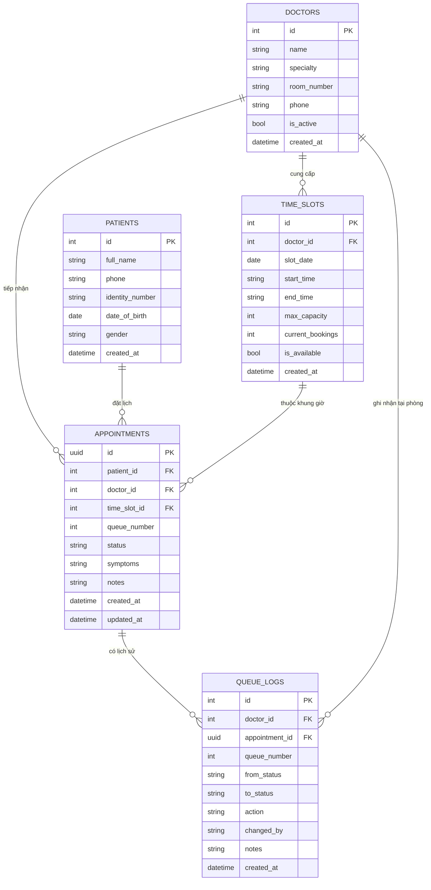

# THIẾT KẾ CƠ SỞ DỮ LIỆU VÀ SƠ ĐỒ ERD
## Đề tài 09: Hệ thống Đặt lịch khám và Quản lý hàng đợi (Clinic Appointment & Queue Management)

---

## 1. Sơ đồ quan hệ thực thể (ERD Diagram)

---

## 2. Chi tiết các bảng dữ liệu

### 2.1. Bảng `doctors` (Danh mục Bác sĩ / Phòng khám)
| Cột | Kiểu dữ liệu | Ràng buộc | Ý nghĩa |
|---|---|---|---|
| `id` | SERIAL | PRIMARY KEY | Mã định danh bác sĩ |
| `name` | VARCHAR(120) | NOT NULL | Họ tên bác sĩ |
| `specialty` | VARCHAR(100) | NOT NULL | Chuyên khoa (Tim mạch, Nhi khoa, v.v.) |
| `room_number` | VARCHAR(20) | NOT NULL | Số phòng khám (P.101, P.202) |
| `phone` | VARCHAR(20) | NULL | Số điện thoại nội bộ |
| `is_active` | BOOLEAN | DEFAULT TRUE | Trạng thái hoạt động |
| `created_at` | TIMESTAMPTZ | DEFAULT NOW() | Thời điểm tạo |

### 2.2. Bảng `time_slots` (Khung giờ khám bệnh)
| Cột | Kiểu dữ liệu | Ràng buộc | Ý nghĩa |
|---|---|---|---|
| `id` | SERIAL | PRIMARY KEY | Mã khung giờ |
| `doctor_id` | INT | FK `doctors(id)` | Thuộc bác sĩ nào |
| `slot_date` | DATE | NOT NULL | Ngày khám |
| `start_time` | VARCHAR(10) | NOT NULL | Giờ bắt đầu (`08:00`) |
| `end_time` | VARCHAR(10) | NOT NULL | Giờ kết thúc (`09:00`) |
| `max_capacity` | INT | DEFAULT 5 | Số lượng bệnh nhân tối đa |
| `current_bookings` | INT | DEFAULT 0 | Số lượng đã đặt lịch |
| `is_available` | BOOLEAN | DEFAULT TRUE | Còn nhận đặt hay đã khóa |
| `created_at` | TIMESTAMPTZ | DEFAULT NOW() | Thời điểm tạo |

### 2.3. Bảng `patients` (Hồ sơ Bệnh nhân)
| Cột | Kiểu dữ liệu | Ràng buộc | Ý nghĩa |
|---|---|---|---|
| `id` | SERIAL | PRIMARY KEY | Mã định danh bệnh nhân |
| `full_name` | VARCHAR(120) | NOT NULL | Họ và tên |
| `phone` | VARCHAR(20) | NOT NULL | Số điện thoại liên hệ |
| `identity_number` | VARCHAR(30) | NULL | CCCD / Số định danh cá nhân |
| `date_of_birth` | DATE | NULL | Ngày tháng năm sinh |
| `gender` | VARCHAR(10) | NULL | Giới tính (Nam/Nữ) |
| `created_at` | TIMESTAMPTZ | DEFAULT NOW() | Thời điểm tạo hồ sơ |

### 2.4. Bảng `appointments` (Lịch hẹn khám & Số thứ tự)
| Cột | Kiểu dữ liệu | Ràng buộc | Ý nghĩa |
|---|---|---|---|
| `id` | UUID | PRIMARY KEY | Mã định danh duy nhất lịch khám |
| `patient_id` | INT | FK `patients(id)` | Bệnh nhân đặt khám |
| `doctor_id` | INT | FK `doctors(id)` | Bác sĩ khám |
| `time_slot_id` | INT | FK `time_slots(id)` | Khung giờ đã chọn |
| `queue_number` | INT | NULL | Số thứ tự khám (sinh tự động) |
| `status` | VARCHAR(30) | NOT NULL | Trạng thái (`Pending`, `Confirmed`, `Serving`, `Completed`, `Cancelled`, `NoShow`) |
| `symptoms` | TEXT | NULL | Triệu chứng mô tả |
| `notes` | TEXT | NULL | Ghi chú thêm |
| `created_at` | TIMESTAMPTZ | DEFAULT NOW() | Thời điểm đặt lịch |
| `updated_at` | TIMESTAMPTZ | DEFAULT NOW() | Thời điểm cập nhật cuối |

### 2.5. Bảng `queue_logs` (Nhật ký kiểm toán hàng đợi)
| Cột | Kiểu dữ liệu | Ràng buộc | Ý nghĩa |
|---|---|---|---|
| `id` | SERIAL | PRIMARY KEY | Mã log |
| `doctor_id` | INT | FK `doctors(id)` | Phòng khám ghi nhận sự kiện |
| `appointment_id` | UUID | FK `appointments(id)` | Lịch khám liên quan |
| `queue_number` | INT | NOT NULL | Số thứ tự tại thời điểm ghi log |
| `from_status` | VARCHAR(30) | NULL | Trạng thái trước đó |
| `to_status` | VARCHAR(30) | NOT NULL | Trạng thái mới |
| `action` | VARCHAR(50) | NOT NULL | Hành động thực hiện (`AssignQueueNumber`, `CallNext`, `CompleteServing`, v.v.) |
| `changed_by` | VARCHAR(60) | NOT NULL | Tác nhân thay đổi (`Patient`, `QueueWorker`, `Doctor`) |
| `notes` | TEXT | NULL | Ghi chú chi tiết |
| `created_at` | TIMESTAMPTZ | DEFAULT NOW() | Thời điểm ghi nhận |
