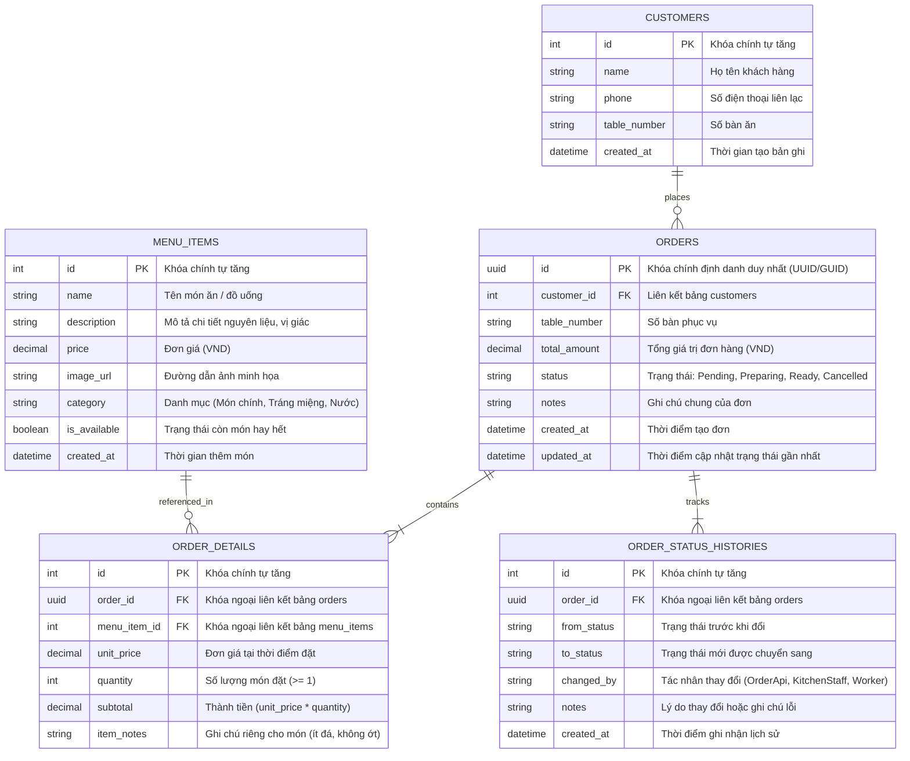

# THIẾT KẾ CƠ SỞ DỮ LIỆU VÀ SƠ ĐỒ THỰC THỂ QUAN HỆ (ERD)
## Đề tài 04: Hệ thống Đặt món và Xử lý tại Bếp

---

## 1. Sơ đồ Thực thể Quan hệ (Entity-Relationship Diagram - ERD)

---

## 2. Từ điển Dữ liệu Chi tiết (Data Dictionary)

### 2.1. Bảng `customers` (Khách hàng)
Lưu trữ thông tin khách hàng đặt bàn và gọi món.

| Tên cột | Kiểu dữ liệu | Ràng buộc | Mô tả |
|---|---|---|---|
| `id` | `SERIAL` | `PRIMARY KEY` | Định danh khách hàng tự tăng |
| `name` | `VARCHAR(100)` | `NOT NULL` | Tên người đặt món |
| `phone` | `VARCHAR(20)` | `NULL` | Số điện thoại |
| `table_number` | `VARCHAR(20)` | `NOT NULL` | Số bàn ngồi ăn (Bàn 01, Bàn VIP,...) |
| `created_at` | `TIMESTAMP WITH TIME ZONE` | `DEFAULT CURRENT_TIMESTAMP` | Thời điểm tạo |

---

### 2.2. Bảng `menu_items` (Thực đơn món ăn)
Lưu trữ danh sách các món ăn, đồ uống phục vụ tại quán.

| Tên cột | Kiểu dữ liệu | Ràng buộc | Mô tả |
|---|---|---|---|
| `id` | `SERIAL` | `PRIMARY KEY` | Mã định danh món ăn |
| `name` | `VARCHAR(150)` | `NOT NULL` | Tên món ăn |
| `description` | `TEXT` | `NULL` | Mô tả chi tiết món |
| `price` | `NUMERIC(12, 2)` | `NOT NULL, CHECK (price >= 0)` | Đơn giá món ăn |
| `image_url` | `VARCHAR(500)` | `NULL` | Link hình ảnh đại diện |
| `category` | `VARCHAR(50)` | `NOT NULL` | Danh mục (Ví dụ: `Món chính`, `Đồ uống`, `Tráng miệng`) |
| `is_available` | `BOOLEAN` | `DEFAULT TRUE` | `true`: còn hàng, `false`: tạm hết hàng |
| `created_at` | `TIMESTAMP WITH TIME ZONE` | `DEFAULT CURRENT_TIMESTAMP` | Thời điểm tạo món |

---

### 2.3. Bảng `orders` (Đơn đặt hàng)
Lưu trữ thông tin tổng quan của từng đơn hàng. Sử dụng `UUID` làm khóa chính để đảm bảo tính phân tán duy nhất trên toàn hệ thống mà không lo xung đột khi scale.

| Tên cột | Kiểu dữ liệu | Ràng buộc | Mô tả |
|---|---|---|---|
| `id` | `UUID` | `PRIMARY KEY` | Định danh đơn hàng (Global Unique ID) |
| `customer_id` | `INT` | `REFERENCES customers(id)` | Liên kết khách hàng |
| `table_number` | `VARCHAR(20)` | `NOT NULL` | Số bàn của đơn |
| `total_amount` | `NUMERIC(12, 2)` | `NOT NULL, CHECK (total_amount >= 0)` | Tổng giá trị toàn đơn hàng |
| `status` | `VARCHAR(20)` | `NOT NULL, CHECK (status IN ('Pending', 'Preparing', 'Ready', 'Cancelled'))` | Trạng thái xử lý |
| `notes` | `TEXT` | `NULL` | Ghi chú chung của khách |
| `created_at` | `TIMESTAMP WITH TIME ZONE` | `DEFAULT CURRENT_TIMESTAMP` | Thời điểm tạo đơn |
| `updated_at` | `TIMESTAMP WITH TIME ZONE` | `DEFAULT CURRENT_TIMESTAMP` | Thời điểm trạng thái thay đổi |

---

### 2.4. Bảng `order_details` (Chi tiết đơn hàng)
Lưu từng món ăn trong đơn, số lượng, và bảo toàn giá trị tại thời điểm mua (`unit_price`).

| Tên cột | Kiểu dữ liệu | Ràng buộc | Mô tả |
|---|---|---|---|
| `id` | `SERIAL` | `PRIMARY KEY` | Định danh chi tiết đơn |
| `order_id` | `UUID` | `NOT NULL, REFERENCES orders(id) ON DELETE CASCADE` | Mã đơn hàng tương ứng |
| `menu_item_id` | `INT` | `NOT NULL, REFERENCES menu_items(id)` | Mã món ăn được chọn |
| `unit_price` | `NUMERIC(12, 2)` | `NOT NULL, CHECK (unit_price >= 0)` | Đơn giá tại thời điểm đặt |
| `quantity` | `INT` | `NOT NULL, CHECK (quantity > 0)` | Số lượng đặt |
| `subtotal` | `NUMERIC(12, 2)` | `NOT NULL, CHECK (subtotal >= 0)` | Thành tiền (`unit_price * quantity`) |
| `item_notes` | `VARCHAR(255)` | `NULL` | Ghi chú món (VD: Không hành, ít ngọt) |

---

### 2.5. Bảng `order_status_histories` (Lịch sử trạng thái đơn)
Lưu vết toàn bộ quá trình dịch chuyển trạng thái của đơn phục vụ audit và hiển thị timeline trên giao diện khách hàng.

| Tên cột | Kiểu dữ liệu | Ràng buộc | Mô tả |
|---|---|---|---|
| `id` | `SERIAL` | `PRIMARY KEY` | Định danh bản ghi lịch sử |
| `order_id` | `UUID` | `NOT NULL, REFERENCES orders(id) ON DELETE CASCADE` | Mã đơn hàng |
| `from_status` | `VARCHAR(20)` | `NULL` | Trạng thái trước đó |
| `to_status` | `VARCHAR(20)` | `NOT NULL` | Trạng thái chuyển tới |
| `changed_by` | `VARCHAR(50)` | `NOT NULL` | Tác nhân thực hiện (`OrderApi`, `KitchenWorker`, `Chef`) |
| `notes` | `TEXT` | `NULL` | Ghi chú kèm theo (VD: Bếp bắt đầu làm) |
| `created_at` | `TIMESTAMP WITH TIME ZONE` | `DEFAULT CURRENT_TIMESTAMP` | Thời điểm diễn ra sự kiện |

---

## 3. Các Chỉ mục (Indexes) Tối ưu Truy vấn Phân tán

1. `CREATE INDEX idx_orders_status ON orders(status);`  
   $\to$ Tối ưu cho Kitchen Worker và Dashboard khi lấy danh sách đơn `Pending` hoặc `Preparing`.
2. `CREATE INDEX idx_orders_customer_id ON orders(customer_id);`  
   $\to$ Tối ưu khi khách hàng tra cứu các đơn mình đã đặt.
3. `CREATE INDEX idx_order_details_order_id ON order_details(order_id);`  
   $\to$ Tối ưu khi join chi tiết món ăn trong một đơn hàng.
4. `CREATE INDEX idx_order_status_histories_order_id ON order_status_histories(order_id);`  
   $\to$ Tối ưu khi truy vấn timeline lịch sử trạng thái của một đơn hàng.
